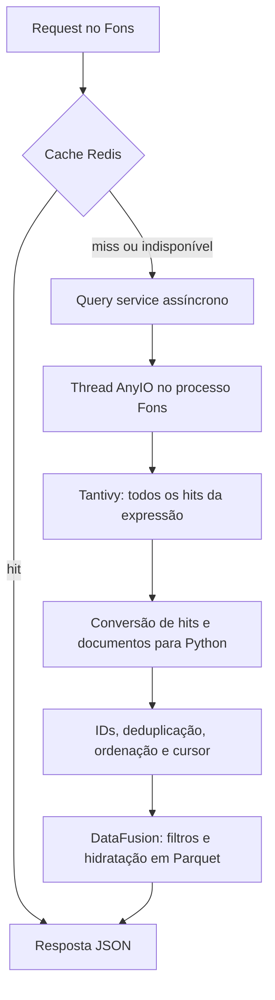
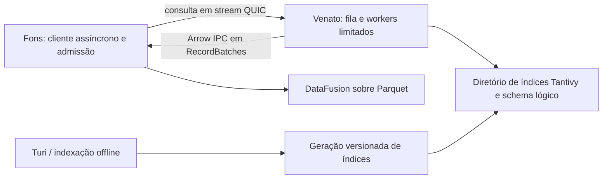

# Venato como servidor: concorrência, isolamento e custo de busca

Relatório de 2026-11-07. Analisa o código e os índices locais presentes nesta
sessão, incluindo alterações ainda não commitadas. Nenhuma mudança de produção
foi implementada. Medições, versões e hashes das fontes estão na
[auditoria JSON](audits/venato_concurrency_2026-11-07.json); o
[script de reprodução](audits/venato_concurrency_2026-11-07.py) acompanha o relatório.

Direção indicada pelo usuário após o diagnóstico: serviço de consulta sobre um
diretório de índices Tantivy existentes, sem ingestão, usando QUIC e Apache Arrow
no transporte. As seções de proposta incorporam esse recorte; ele ainda não foi
implementado ou medido.

## Parecer

A suspeita tem fundamento e foi reproduzida localmente: pesquisas abrangentes
concorrentes aumentam a memória do Fons, reduzem a eficiência das próprias buscas
e provocam picos de latência em uma rota que não usa Venato. O efeito depende
fortemente da quantidade de correspondências, não apenas da taxa de requests.

Uma versão servidor faz sentido como fronteira de isolamento e controle de carga.
Minha recomendação é começar com limites de admissão no Fons e evoluir para um
processo Venato dedicado, inicialmente na mesma máquina. Para resolver também o
custo por request, será necessário mudar o contrato de busca para evitar devolver
todos os IDs. Mudar somente o transporte da implementação atual não resolve isso.

Os resultados não demonstram colapso generalizado: a mediana da rota leve
permaneceu próxima da referência. Demonstram aumento das caudas de latência,
pausas no loop e crescimento de memória já com oito pesquisas abrangentes.

## Caminho atual de uma request



Em pessoas, Venato e DataFusion são duas chamadas sucessivas a
`anyio.to_thread.run_sync`. Em empresas, as duas buscas, a fusão do ranking e a
hidratação ficam dentro de uma única execução em thread. As dependências são
montadas uma vez no startup, compartilhando uma sessão DataFusion por processo.

O trabalho pesado já sai do corpo assíncrono da rota. Portanto, não encontrei
uma chamada síncrona de busca executada diretamente no event loop. Isso protege
contra um tipo de bloqueio, mas threads continuam compartilhando CPU, memória,
GIL, disco e recursos da API.

Fontes locais: [startup do Fons](../apps/fons/main.py),
[montagem das dependências](../apps/fons/bootstrap.py),
[pessoas](../apps/fons/infra/opendata/public_people/query_service.py) e
[empresas](../apps/fons/infra/opendata/business/query_service.py).

## Achados principais

### 1. A paginação HTTP não limita o trabalho textual

`Venato._iter_scored_documents` executa:

```python
results = searcher.search(query, limit=searcher.num_docs, count=False)
for score, address in results.hits:
    document = searcher.doc(address).to_dict()
```

O limite é o número de documentos do índice, permitindo coletar todas as
correspondências. `count=False` dispensa a contagem explícita; não transforma a
operação em uma busca dos primeiros 20 itens. O gerador evita uma lista adicional
de todos os documentos, mas os hits e a lista final de IDs continuam completos.

Depois dessa etapa:

- Pessoas aplicam filtros e cursor no DataFusion. Por relevância, consultam lotes
  de 1.000 IDs até preencher a página; por ID, passam a lista de correspondências
  para `IN (?)`, que o adaptador expande em parâmetros individuais.
- Empresas percorrem dois índices, deduplicam por empresa e ordenam o conjunto
  encontrado antes de hidratar lotes do tamanho da página. No índice de
  estabelecimentos, a referência de interesse é `empresa_id`.
- Cada próxima página repete a busca textual completa. Não existe reutilização
  do conjunto de candidatos entre páginas diferentes no Venato atual.

Logo, uma resposta de 20 registros pode exigir centenas de milhares ou milhões
de hits, conversões e objetos intermediários. Isso é comportamento explícito do
[core do Venato](../avoar/infra/venato/core.py), necessário ao contrato atual de
filtrar e ordenar depois da busca.

### 2. O orçamento de threads é compartilhado e muito permissivo

O startup configura `current_default_thread_limiter().total_tokens = 650`.
As buscas e várias consultas de detalhes usam `run_sync` sem limitador próprio.
São até 650 execuções admitidas nesse mecanismo por processo; não significa que
650 threads já existam ou que o runtime DataFusion tenha esse mesmo limite.

Não encontrei uma fila de busca com tamanho máximo, limite específico por
workload, rejeição por sobrecarga ou prazo interno de execução no caminho analisado.
Ao disputar todos os tokens, pesquisas podem atrasar operações que também usam
esse limitador. Muito antes disso, podem saturar CPU ou memória. O benchmark
chegou apenas a oito buscas: não mediu esgotamento dos 650 tokens.

O pool `DATAFUSION_MEMORY_LIMIT` limita o runtime DataFusion, não o RSS do processo
nem as listas Python, os resultados do Tantivy ou todas as alocações Arrow.
Na medição com pool de 512 MiB, o processo passou de 1,6 GiB de RSS.

### 3. Rust e threads não eliminam o custo na fronteira Python

O binding `tantivy-py` 0.26.0 consultado libera o GIL na busca nativa e na leitura
de documentos com `py.detach`. A conversão de `SearchResult.hits` cria valores
Python, e o Venato percorre os resultados, monta dicionários e restaura campos
unsigned. Portanto, seria incorreto atribuir toda a busca a um bloqueio contínuo
do GIL. Há fases nativas paralelizáveis e fases que disputam o interpretador.
Veja o [código do binding](https://raw.githubusercontent.com/quickwit-oss/tantivy-py/0.26.0/src/searcher.rs).

O ambiente medido usa CPython com GIL habilitado. Threads compartilham esse
interpretador; processos separados têm seu próprio interpretador. Essa distinção
está na [documentação do Python](https://docs.python.org/3.14/library/threading.html#gil-and-performance-considerations).
As medições por etapa abaixo identificam custos; não são um perfil capaz de
atribuir cada pausa exclusivamente ao GIL, ao alocador ou ao escalonador.

### 4. Cache e timeout do frontend não são controle de carga

O Redis reduz trabalho quando a URL já está em cache. O caminho atual não
consolida misses simultâneos da mesma chave: várias requests podem executar a
mesma busca. Termos, filtros e páginas diferentes também geram trabalho próprio.
Se o cache falha, o Fons continua consultando a fonte. Isso preserva disponibilidade,
mas pode aumentar a carga justamente durante a falha.

O Rostra usa timeout de 15 segundos para essas chamadas. Cancelar a espera no
cliente não garante interromper a thread nem a busca nativa no servidor.
`run_sync` não recebe opções de cancelamento no código atual; mesmo abandonar a
espera não mata a thread. A [documentação AnyIO](https://anyio.readthedocs.io/en/stable/threads.html)
explica essa limitação. Uma proteção efetiva precisa impedir admissão excessiva
e controlar também o trabalho já iniciado.

Fontes: [cache Fons](../apps/fons/infra/cache/response_cache.py) e
[prazos Rostra](../apps/rostra/src/lib/api/request-policy.ts).

## Medições locais

### Tamanho real dos índices

Leitura dos índices existentes; o espaço corresponde a blocos alocados no disco,
aproximado em GiB. Contagem de documentos não é auditoria de entidades únicas.

| Índice | Documentos | Disco |
|---|---:|---:|
| Pessoas | 599.577 | 0,024 GiB |
| Empresas | 69.523.294 | 3,47 GiB |
| Estabelecimentos | 72.605.022 | 8,21 GiB |
| Endereços | 111.102.875 | 3,77 GiB |

`comercio` encontrou 2.367.259 documentos em empresas e 395.359 em
estabelecimentos. `Petrobras` encontrou 331 e 781, respectivamente. A consulta
`*` foi aceita pelo parser e encontrou todos os documentos de cada índice.
O índice de endereços foi inventariado; não foi identificado como chamado pelos
dois endpoints de pesquisa textual analisados.

Para os índices grandes, executei somente top 20 com contagem. Não coletei todos
os IDs dessas expressões nem submeti suas versões abrangentes aos endpoints.
Mesmo 69,5 milhões de IDs em um vetor compacto de u64 exigiriam cerca de 530 MiB,
antes de hits, scores, objetos Python e deduplicação. Essa é uma conta de tamanho,
não uma medição da memória de uma busca empresarial.

### Onde uma busca de pessoas gasta tempo

Três execuções por expressão, sem HTTP nem DataFusion. Medianas, em milissegundos.
A instrumentação separa as etapas equivalentes ao core, sem substituí-lo na API.

| Expressão | Hits | YAML/parser | Busca nativa | Hits para Python | Documentos e IDs | Total |
|---|---:|---:|---:|---:|---:|---:|
| `Silva` | 6.738 | 0,99 | 0,35 | 0,24 | 9,83 | 11,40 |
| `*` | 599.577 | 0,92 | 5,47 | 26,25 | 474,24 | 506,67 |

As medianas das colunas não precisam somar exatamente a mediana do total.
Neste caso abrangente, a extração dos documentos/IDs custa muito mais que a
busca nativa. Cachear o YAML é uma melhoria pequena diante desse custo.

O binding instalado expõe `fast_field_values`, uma possibilidade de leitura de
IDs em lote sem `doc().to_dict()` para cada hit. Pessoas já declaram `id` como
`fast`; os IDs necessários de empresas/estabelecimentos não são `fast` nos YAMLs
atuais. Essa otimização não foi implementada nem medida e pode exigir
reindexação nesses outros índices. Ela tampouco limita a quantidade de hits.

### Concorrência usando o app real

App Litestar com lifespan e montagem real de dependências, Parquets e Venato
locais, via `httpx.ASGITransport`. Redis e warmup desabilitados; DataFusion com
512 MiB e duas partições. Python 3.14.9, Tantivy 0.26.0, AnyIO 4.12.1,
Litestar 2.24.0, DataFusion 55.0.0; 12 CPUs lógicas visíveis.

Cada cenário rodou em processo novo, com três rajadas. Todas as buscas retornaram
200 e 20 registros. Uma segunda sequência consultou `/opendata/organ/` durante a
carga, com intervalo de 20 ms após cada resposta. Antes da carga, 25 chamadas
mediram a referência dessa rota, cuja mediana ficou entre 10,4 e 10,9 ms.

| Cenário | Mediana da busca | Vazão da rajada | Pico RSS do processo | Maior latência de órgãos | Maior atraso do loop |
|---|---:|---:|---:|---:|---:|
| `*`, 1 simultânea | 682 ms | 1,43/s | 564 MiB | 77 ms | 67 ms |
| `*`, 4 simultâneas | 3.913 ms | 0,99/s | 1.042 MiB | 90 ms | 292 ms |
| `*`, 8 simultâneas | 8.675 ms | 0,91/s | 1.715 MiB | 516 ms | 494 ms |
| `*`, 4 requests, admissão de 1 por vez | 1.620 ms | 1,49/s | 616 MiB | 75 ms | 65 ms |
| `Silva`, 4 simultâneas | 157 ms | 23,86/s | 950 MiB | 17 ms | 5 ms |

A mediana da busca reúne as latências das três rajadas; a vazão é a mediana das
taxas de conclusão por rajada, incluindo a instrumentação. Os máximos são os
maiores valores observados, sem pretensão de estimar p99. RSS é o maior valor
do processo inteiro desde seu início, incluindo imports, startup, mapeamentos,
DataFusion e memória retida pelo alocador. Não é memória incremental do Venato;
por isso, não se deve atribuir a ele isoladamente o RSS do cenário `Silva`.

O cenário de admissão usou um semáforo somente no script, ao redor do método
real de pesquisa de pessoas. As quatro requests continuaram concorrentes, mas
apenas uma executou a pesquisa por vez. Sua latência inclui a espera. O tempo
mediano para concluir o grupo caiu de 4,03 para 2,68 segundos, com menor RSS.
Isso demonstra que mais paralelismo piorou esse workload e que contenção simples
já pode ajudar; não estabelece que uma vaga seja o melhor limite em produção.

Na rota de órgãos, as medianas durante `*` ficaram entre 10,5 e 11,0 ms.
O efeito cruzado apareceu nos picos, chegando a 516 ms com oito buscas.
Não foi demonstrada piora generalizada de todas as respostas da API.

### Limites da evidência

- É uma amostra diagnóstica em máquina de desenvolvimento, sem isolamento dos
  demais processos. Cenários foram sequenciais, sem ordem aleatória ou cache
  de disco explicitamente frio. Índices de pessoas foram abertos antes da carga.
- ASGITransport não mede TCP, proxy, TLS, filas do servidor ASGI nem o custo de
  transportar resultados a outro processo. Cliente e aplicação compartilham o
  loop do teste; o gerador de probes também sofre suas pausas.
- Um heartbeat de 10 ms, presente em todos os cenários API, segue o workaround
  de testes Python 3.14/AnyIO já registrado na memória. Não é mudança de produção.
- Houve três rajadas por cenário, sem carga sustentada, modelagem de chegadas,
  falha de Redis ou saturação de 650 execuções. As taxas acima não são limites
  de requests por segundo da instalação.
- Não medi o servidor proposto, ProcessPool, OOM ou buscas empresariais completas
  de milhões de hits. O benefício esperado de isolamento é uma inferência de
  arquitetura, ainda sujeito a medição.

## O que uma versão servidor resolveria

| Aspecto | Biblioteca atual | Processo Venato dedicado |
|---|---|---|
| Interpretador, heap e falhas | Compartilhados com Fons | Separados do Fons |
| Concorrência de busca | Limitador AnyIO geral | Orçamento próprio e fila limitada |
| Reinício/reload de índices | Acoplado ao processo API | Ciclo de vida independente |
| CPU, RAM física e disco da máquina | Compartilhados | Continuam compartilhados; exigem quotas para proteção forte |
| Todos os hits por consulta | Coletados | Continuam caros se o contrato for igual |
| Hidratação e filtros DataFusion | Dentro do Fons | Continuam no Fons na proposta inicial |
| Transporte | Chamada em memória | Serialização, conexão e custo operacional adicionais |

Um serviço Python separado já isola o GIL e o heap da busca em relação ao Fons;
não é necessário começar reescrevendo o motor em Rust. Dentro desse serviço,
threads ainda têm as mesmas limitações. Se uma instância não bastar, workers
em processos independentes são uma opção a medir.

Um pool de processos supervisionado pelo Fons é alternativa intermediária:
dispensa protocolo HTTP, mas exige inicialização dos índices por worker,
controle da fila, transferência de resultados e recuperação de falhas.
Não deve simplesmente receber milhões de IDs por request e copiá-los de volta.

Multiplicar workers do Fons inteiro também cria interpretadores separados,
mas replica cores/sessões/orçamentos DataFusion e não reserva recursos para
rotas leves. É uma opção de implantação a avaliar, com menor precisão de isolamento.

## Proposta de implementação incremental

### Etapa 1: conter e observar no Fons

1. Criar admissão específica para pesquisa antes de ocupar threads: quantidade
   ativa limitada, número máximo de pendentes e prazo curto de espera.
   Um semáforo isolado não limita o número de requests esperando.
2. Medir pequenos limites, por exemplo 1, 2 e 4 buscas ativas por processo,
   juntamente com o orçamento DataFusion e o número de workers. Não substituir
   o valor 650 por outro número arbitrário como solução global.
3. Rejeitar sobrecarga de serviço com 503 e `Retry-After`; reservar 429 para
   limites de taxa por cliente, quando adotados. Uniformizar erros de sintaxe
   e indisponibilidade entre pessoas e empresas.
4. Consolidar requests idênticas em andamento, com chaves que incluam índice,
   geração e parâmetros. Manter cache/fila com limites de entradas e bytes.
5. Registrar espera, duração nativa, extração de IDs, hidratação, hits,
   bytes intermediários, rejeições, RSS e atraso do loop. Evitar registrar
   indiscriminadamente o texto bruto pesquisado.

Limitar o tamanho da expressão de pessoas, como já ocorre em empresas, ajuda a
validar a entrada, mas não limita sua abrangência: `*` tem um caractere. Qualquer
política de complexidade/hits deve ser explícita. Não truncar silenciosamente
resultados válidos para caber num orçamento.

### Etapa 2: separar o processo, preservando o modelo colunar



Manter a biblioteca como núcleo reutilizável e acrescentar um servidor de leitura
com QUIC e Arrow, conforme o recorte do usuário. O servidor recebe a configuração
do diretório, abre os índices existentes e atende consultas. Não expõe criação,
ingestão, upload de documentos, commit, prune ou execução de produtores. Não
precisa abrir os Parquets de origem; a indexação continua em ferramenta/processo
externo. Começar na mesma máquina, com conexões QUIC persistentes e limitadas.
Não há necessidade inicial de Nats, cluster ou replicação.

O serviço deve ter índices/campos permitidos, readiness, deadlines e controle de
fila. Fons precisa limitar também quantas chamadas envia: um cliente assíncrono
sem admissão pode apenas transferir o acúmulo para conexões e requests pendentes.
Falha do Venato deve produzir indisponibilidade da busca, preservando as rotas
que consultam somente Parquet. Não fazer fallback automático irrestrito para
busca embutida durante sobrecarga.

Separar indexação de atendimento. A ingestão atual pede heap de 2 GiB e 12 threads
ao writer; é um orçamento de indexação, não de pesquisa. Construir uma nova
geração fora do índice servido, validá-la e publicar uma troca de geração,
mantendo a anterior enquanto houver consultas/cursor válidos. O `prune_all`
atual remove diretórios; não é um mecanismo de publicação sem interrupção.

Além disso, `_indexes` é hoje um atributo de classe, indexado apenas por
`index_id`. Isso compartilha handles entre instâncias mesmo quando `data_dir`
difere. Para suportar gerações, clientes e testes com isolamento, o registro
precisará ter dono explícito e identidade que considere diretório/geração.
O carregamento inicial também deve evitar aberturas concorrentes redundantes.

Os YAMLs continuam sendo a declaração lógica, com restauração de todos os campos
`u64` armazenados como `i64`. O servidor precisa desse metadado junto dos índices,
por configuração ou manifesto produzido a partir dos YAMLs: o schema físico
Tantivy não distingue esses IDs de inteiros realmente signed. O manifesto deve
acompanhar a geração do índice; não pode fixar nomes de campos no servidor.
Projeções precisam respeitar a disponibilidade em `stored` ou `fast`, rejeitando
campos que o índice não consiga devolver. Campos apenas indexados continuam
pesquisáveis, mas não podem ser reconstruídos como dados cadastrais.

No Arrow, IDs permanecem `uint64`. A conversão para strings ocorre na borda JSON
pública do Fons, preservando valores acima de 2^53.
Parquets permanecem a fonte cadastral; não é necessário materializar documentos
completos no servidor de busca nem introduzir DuckDB.

### Contrato proposto: Arrow IPC sobre streams QUIC

Esta subseção é uma proposta de protocolo, não resultado de benchmark.
Usar streams QUIC confiáveis e ordenados, com uma consulta por stream
bidirecional e várias consultas multiplexadas numa conexão persistente.
O RFC descreve streams como sequências de bytes sem fronteiras de mensagens;
por isso, não se pode associar um pacote UDP ou uma chamada de leitura a um lote.
Referência: [RFC 9000, seção 2](https://www.rfc-editor.org/rfc/rfc9000.html#section-2).

Para os resultados, usar o formato padrão **Arrow IPC streaming**, com schema,
RecordBatches e término de stream. Definir um envelope de aplicação para versão,
operação, status, geração e continuação, sem misturar bytes de controle
arbitrariamente dentro do IPC. A especificação Arrow já define o enquadramento
de suas mensagens; não é necessário criar um formato colunar próprio.
Referência: [formato Arrow IPC](https://arrow.apache.org/docs/format/Columnar.html#ipc-streaming-format).

| Parte do contrato | Proposta |
|---|---|
| Consulta | Índice lógico, expressão, campos de busca, projeção, ordenação, cursor e prazo |
| Resultado | Campos projetados e score original, com tipos Arrow explícitos |
| Lotes | Limites de linhas e bytes, com fila de produção limitada |
| Continuação | Cursor opaco associado à consulta, ordenação e geração |
| Término | Distinguir esgotamento, continuação, erro e cancelamento; stream parcial não equivale a sucesso |
| Metadados | Versão, schema lógico e geração; sem caminhos arbitrários enviados pelo cliente |

Por exemplo, uma pesquisa de pessoas poderia devolver `id: uint64` e
`score: float32`, mantendo a precisão nativa do score Tantivy. Estabelecimentos
podem projetar também `empresa_id: uint64`, conforme o schema. Esses são exemplos
de projeção do cliente, não colunas fixas do protocolo. A necessidade de uma
posição no ranking deve ser explícita se houver reordenação posterior.

O cliente deve consumir RecordBatches sem convertê-los imediatamente em listas
de dicionários. O servidor também deve construir arrays por lote, evitando
acumular todos os documentos Python antes de escrever Arrow. O benefício esperado
é reduzir objetos e conversões na fronteira entre processos; Arrow sobre rede
não garante ausência de cópias, buffers ou custo de criptografia.

Fluxo QUIC e orçamento de execução são controles diferentes. O produtor deve
parar de avançar quando sua fila de lotes atingir o orçamento, sem enfileirar o
resultado inteiro no transporte. Além de limitar streams/conexões, limitar
consultas ativas e pendentes. Reset ou abandono de stream deve sinalizar a
interrupção da produção; parar uma busca Tantivy já em andamento exige suporte
cooperativo ou outra estratégia de execução, não apenas fechar a conexão.

Também é necessário distinguir **streaming de transporte** de **coleta
incremental**: executar hoje `limit=searcher.num_docs` e depois dividir os hits em
RecordBatches ainda materializaria todos os hits. Uma primeira versão assim
isola o Fons e melhora o contrato de transferência, mas mantém o custo de coleta
no Venato. A etapa seguinte precisa tratar o coletor e a semântica do ranking.

Arrow Flight é uma referência útil de APIs de dados, mas o protocolo documentado
é baseado em gRPC e Arrow IPC. Arrow IPC diretamente sobre QUIC exige definir e
manter o protocolo do Venato e seu cliente; não se deve presumir compatibilidade
com clientes Flight existentes. Referência: [Arrow Flight RPC](https://arrow.apache.org/docs/format/Flight.html).

O primeiro protótipo deve medir tempo até o primeiro lote, tempo total, CPU,
RSS, bytes em filas, concorrência e cancelamento. Não há evidência nesta
auditoria de que QUIC seja mais rápido que TCP ou socket local, especialmente
na mesma máquina. A separação de processo e a eliminação de objetos Python são
benefícios distintos da escolha do transporte e precisam ser medidos separadamente.

### Etapa 3: limitar resultados intermediários sem alterar respostas

Definir um contrato versionado que devolva referências, scores, geração do
índice e continuação em lotes com orçamento de itens/bytes. Apenas reduzir o
`limit` de `searcher.search` para 20 quebraria o comportamento atual:

- Filtros de mandatos/candidaturas e referências ausentes podem eliminar os
  primeiros hits. Fons precisa continuar buscando até completar a página ou
  esgotar a pesquisa.
- Pessoas preservam o ranking e seus empates do Venato; por relevância crescente,
  a sequência atual é invertida. O cursor público é o ID da última pessoa.
- Empresas combinam dois corpora, usam o maior score por empresa, deduplicam
  filiais e desempatam por ID crescente nos dois sentidos de relevância.
  O cursor público é `score|ID`. Limitar os primeiros documentos de cada índice
  não prova que os primeiros resultados únicos de empresas estejam completos.
- Ordenação por ID exige capacidade de continuar nessa ordem. Relevância
  crescente por máximo entre corpora também exige uma estratégia própria;
  não é resolvida invertendo lotes de relevância decrescente.

Será necessário escolher entre execução com filtros/coletores mais próximos do
índice, estado de pesquisa limitado e versionado, ou outra estratégia que prove
completude do ranking. Repetir `TopDocs` com offsets crescentes não é uma solução
de paginação profunda: pode recalcular e acumular trabalho. A API pública deve
continuar keyset; mudanças de cursor, snapshot ou expiração exigem contrato
explícito e testes de equivalência.

Essa é a parte mais delicada da evolução. Pode ser entregue separadamente do
isolamento em processo. Uma primeira versão servidor com contrato antigo e
admissão limitada teria valor de contenção, mas sua coleta/transferência completa
de IDs deve permanecer uma limitação declarada, não o desenho final.

## Critérios para decidir a próxima entrega

Recomendo implementar primeiro a admissão e um benchmark com cliente em processo
separado. A direção do serviço é QUIC/Arrow sobre índices existentes; comparar
essa versão com a biblioteca protegida e, se útil, um transporte local de
referência, mantendo o mesmo conjunto de dados e semântica.

A validação deve misturar pesquisas seletivas e abrangentes de pessoas/empresas,
paginação profunda, filtros restritivos, detalhes, votos e rotas pequenas;
medir p50/p95/p99, erros, rejeições, vazão, RSS de cada processo e total da máquina.
Incluir cache hit/miss, misses simultâneos, falha do Venato e atualização de índices.
O critério principal é preservar a latência acordada das demais rotas sob
sobrecarga, com memória limitada e rejeição previsível, não aceitar todas as buscas.

Para correção, preservar IDs unsigned, scores originais, máximo por empresa,
empates, ordem asc/desc, páginas completas após filtros, referências antigas,
ausência e os caminhos `JSON_STRING`/`DICT` sem validação Pydantic. Exercitar
sempre o lifespan e a montagem real de dependências da API.

## Reprodução

Executar um cenário de cada vez, a partir da raiz, sem outras cargas de benchmark:

```bash
PYTHONPATH=apps/fons:. uv run --no-sync python docs/audits/venato_concurrency_2026-11-07.py census
PYTHONPATH=apps/fons:. uv run --no-sync python docs/audits/venato_concurrency_2026-11-07.py stages --query '*'
PYTHONPATH=apps/fons:. uv run --no-sync python docs/audits/venato_concurrency_2026-11-07.py stages --query Silva
PYTHONPATH=apps/fons:. uv run --no-sync python docs/audits/venato_concurrency_2026-11-07.py api --concurrency 1
PYTHONPATH=apps/fons:. uv run --no-sync python docs/audits/venato_concurrency_2026-11-07.py api --concurrency 4
PYTHONPATH=apps/fons:. uv run --no-sync python docs/audits/venato_concurrency_2026-11-07.py api --concurrency 8
PYTHONPATH=apps/fons:. uv run --no-sync python docs/audits/venato_concurrency_2026-11-07.py api --concurrency 4 --search-slots 1
PYTHONPATH=apps/fons:. uv run --no-sync python docs/audits/venato_concurrency_2026-11-07.py api --concurrency 4 --query Silva
```

O script não modifica índices ou Parquets, desabilita Redis no próprio processo
e usa o ciclo normal da sessão DataFusion, que pode criar/remover temporários.
O experimento de admissão modifica somente a instância em memória desse processo.
Resultados variam com o estado dos dados, disco, alocador e processos concorrentes.
